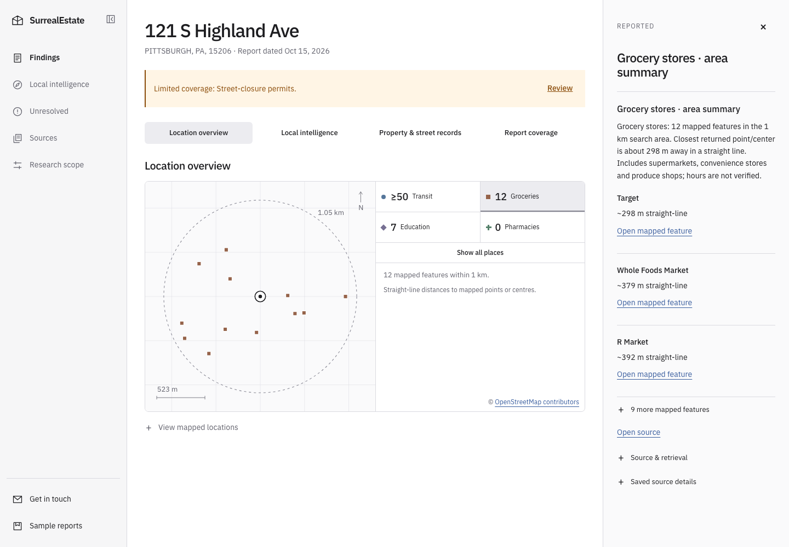
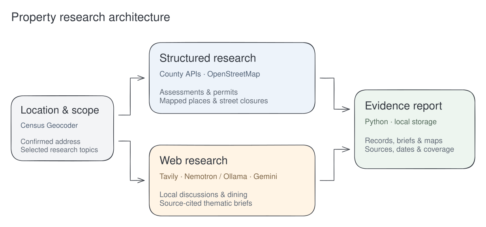
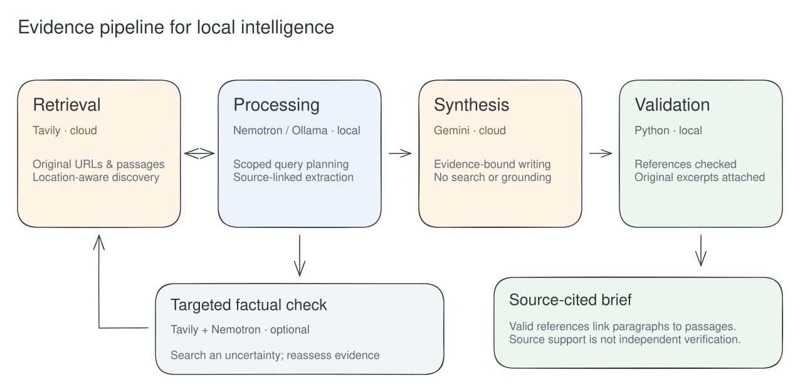
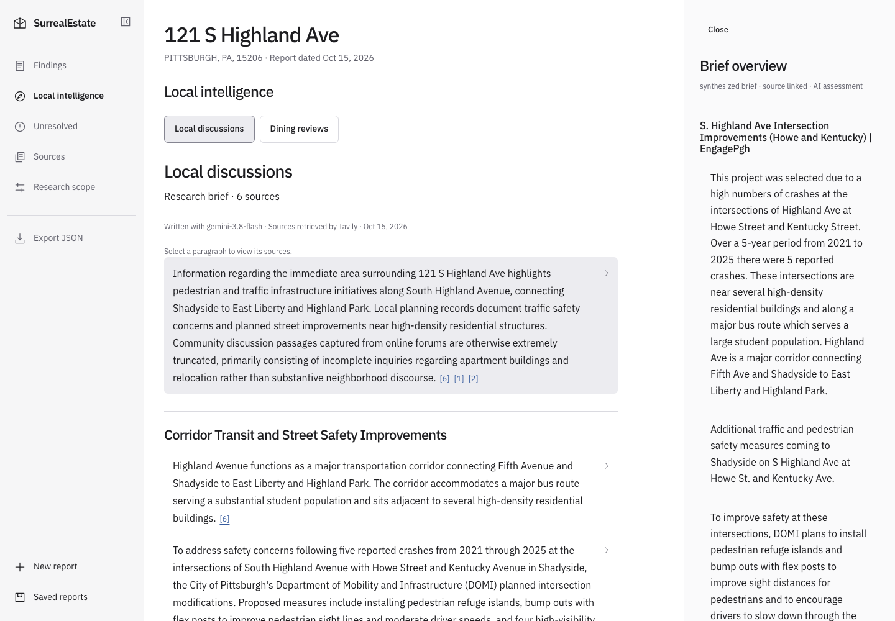

# SurrealEstate

**Know the place behind the address.**

SurrealEstate turns a street address into an explorable research report: property
records, mapped daily essentials, local discussions, and dining research, with the
evidence close at hand. Start with the neighborhood at a glance, read a brief,
then select a paragraph to inspect the passages behind it.

## [Explore the public showcase →](https://lucas-granucci.github.io/surreal-estate/)

Browse real Pittsburgh reports, maps, and cited briefs in your browser.
**No installation, API keys, or sign-in required.**

[Run locally](#run-locally) · [How it works](#two-research-channels)

[](https://lucas-granucci.github.io/surreal-estate/#report/east-liberty)

*Select the screenshot to explore the East Liberty report.*

### See the pipeline in action

[Watch or download the recorded walkthrough](docs/media/pipeline-walkthrough.mp4?raw=true)
— a real run from address entry and Census confirmation through channel selection,
live generation, local intelligence, source inspection, and coverage. The silent
recording speeds up the generation wait by 20×. The live map source was unavailable
in this run, and that coverage gap remains visible.

## What you can explore

- **An address, confirmed.** Review the Census match before starting research.
- **Mapped daily essentials.** Explore groceries, transit, schools, and pharmacies
  within a 1 km search, with approximate straight-line distances and source links.
- **Property and street records.** Read county assessments, parcel-linked building
  permits, and relevant street-closure permits alongside their qualifications.
- **Local intelligence.** Choose local discussions, dining reviews, or both.
  Read thematic briefs drawn from geographically scoped web sources.
- **Evidence beside the brief.** Select a paragraph to inspect its original source
  passages, attribution, and links in the evidence inspector.
- **Visible research limits.** See what completed, returned nothing, was blocked,
  or failed. Missing data stays visible; completed evidence survives provider failures.
- **A local research library.** Reopen saved reports, export source JSON, and retain
  dated snapshots. The reader supports desktop, mobile, and system light/dark themes.

Property and permit coverage focuses on Pittsburgh and Allegheny County. Other
sources vary by location. Web opinions and AI assessments remain distinct from
public records; source citations make claims inspectable, not independently verified.

## Two research channels

Choose either channel or combine them in one report. Public records and nearby
places require no API key or model. Local intelligence adds bounded web research.



### Inside local intelligence



Optional factual checks revisit material uncertainties; they remain AI assessments,
not independent verification. See [the research pipeline](docs/tavily-research.md)
for processing rules and limits.



*A completed local discussion brief from the recorded run, with its cited passages open.*

## Run locally

Python 3.11 or newer is required.

```sh
python3 -m venv .venv
.venv/bin/python -m pip install -e '.[dev]'
.venv/bin/surreal-estate app --port 8765 --data-dir exports/web-app
```

Open `http://127.0.0.1:8765`. The app binds to loopback. Reports are saved locally
and survive restart; deleting a saved report prevents it from being reimported.

The interface follows `design/SurrealEstate.html`, with graphite colors, IBM Plex
Sans, system light/dark themes, a collapsible sidebar and an evidence inspector.
Findings provides records, mapped places and compact web-topic previews. Full Local
discussions and Dining reviews briefs live on Local intelligence; preview links open the
corresponding topic. Source excerpts appear beside the brief, or in a mobile dialog.

For an entirely offline synthetic demonstration:

```sh
.venv/bin/surreal-estate demo --db demo.db
```

## Public records and nearby places

These sources need no API key or model:

| Source | Coverage |
| --- | --- |
| Census Geocoder | Address match and jurisdiction context |
| WPRDC county assessments | Exact address candidates and recorded property values |
| Allegheny County GIS | Address-point and parcel-boundary signals for ambiguous candidates |
| WPRDC PLI permits | Records on the selected county parcel |
| WPRDC DOMI street closures | Bounded same-street segments and recorded work descriptions |
| OpenStreetMap / Overpass | Education, groceries, transit and pharmacies within a 1 km query |

Assessment values are recorded values, not current appraisals. Parcel selection
checks county candidates and labels any stable fallback as uncertain. Unit,
fractional and ranged addresses require explicit handling. Permit absence does not
establish absence of work. Closure dates and geometry limit which segments appear.

Mapped results describe OSM features rather than verified distinct facilities.
Each category has a 50-feature cap; capped counts are lower bounds. Distances are
straight-line measurements to points or centers, not walking times or entrances.
School quality, attendance zones and transit service frequency are not inferred.

The map runs before parcel-dependent lookups. Public requests retry transient
502/503/504 and transport failures once, within the 24-dispatch API budget and
300-second shared deadline. Overpass uses form-encoded QL, a project-identifying
User-Agent, and bounded primary/mirror requests. Successful map results are cached
for 24 hours; if a live refresh fails, saved results up to seven days old can be
shown with their retrieval date and an explicit refresh-unavailable notice. Cached
results never change their original retrieval time. A new location without saved
data still depends on an available source. WPRDC catalogs have a five-minute cache.

```sh
.venv/bin/surreal-estate research --address '121 S Highland Ave, Pittsburgh, PA 15206'
.venv/bin/python scripts/smoke_sources.py --address '121 S Highland Ave, Pittsburgh, PA 15206'
```

## Web research

Copy `.env.example` to `.env` and set:

- `TAVILY_API_KEY` from [Tavily](https://app.tavily.com).
- `TAVILY_SEARCH_DEPTH=basic` or `advanced`.
- `OLLAMA_BASE_URL=http://127.0.0.1:11434` and the installed `OLLAMA_MODEL`.
- `GEMINI_API_KEY` and optional `GEMINI_SYNTHESIS_MODEL` for final brief writing.

Start Ollama with the configured model and restart the app after configuration
changes. Exported environment variables take precedence over `.env`. Credentials
are redacted from debugging and excluded from Git.

Tavily is the only live search provider. Nemotron plans searches, extracts
source-linked notes and optionally requests a targeted factual check. An official
Pittsburgh boundary lookup supplies neighborhood context; street context remains
when that lookup is unavailable. Searches preserve the address area and exclude
unrelated discussion results. A topic has two discovery queries and at most one
check query, within six searches per report.

Gemini receives supplied source material and writes the final thematic brief. It
has no search, grounding or URL-context tools. Paragraph citations resolve to
original passages; invalid formats receive one bounded repair attempt. Unknown
refs, truncated output and unsupported business-hours inferences are rejected.
Writer failures retain research notes and sources. Opinions and AI assessments
remain distinct from public records and independent verification.

```sh
.venv/bin/surreal-estate research --address '121 S Highland Ave, Pittsburgh, PA 15206' --web
.venv/bin/python scripts/smoke_tavily.py
.venv/bin/surreal-estate gemini-models
```

The model diagnostic lists generation-capable models without generating content.
See [Tavily research](docs/tavily-research.md) for processing, budgets and limitations.

## Snapshots and downstream processing

```sh
.venv/bin/surreal-estate research \
  --address '121 S Highland Ave, Pittsburgh, PA 15206' --web \
  --export exports/property.json --durable-export exports/property-durable.json --db research.db
.venv/bin/surreal-estate view exports/property.json --port 8766
```

Snapshots preserve reports and source-linked briefs. Explicit filenames replace
prior files; generated report IDs preserve separate runs. SQLite and durable
exports apply source-retention policy and rebuild claims from retained evidence.
Debug request/response payloads are excluded from saved reports. Historical
transient web content is not converted into downstream evidence.

To rewrite a saved Tavily brief without repeating searches:

```sh
.venv/bin/python scripts/synthesize_brief.py INPUT.json --topic restaurant_reviews --output exports/brief.json
```

This creates a new report ID and preserves the original snapshot.

## Verification

```sh
.venv/bin/pytest -q
node --check surreal_estate/webapp/static/app.js
```

Tests cover source recovery, map caching and outages, parcel matching, policy and
provenance, credential redaction, query context, citations, synthesis failures,
exports, report persistence and local web endpoints. Live provider checks are
separate from deterministic tests and may incur web/model charges.

See [architecture](docs/architecture.md), [web API](docs/webapp-api.md), and
[interface implementation](docs/interface-implementation.md).

## Public showcase

A static, read-only version shares the report reader and visual Location overview
preview with the private app. Build reviewed sample reports with
`python scripts/build_showcase.py --output dist/public`. No API keys or running
model are needed to host the generated files. See [public showcase setup](docs/public-showcase.md).
