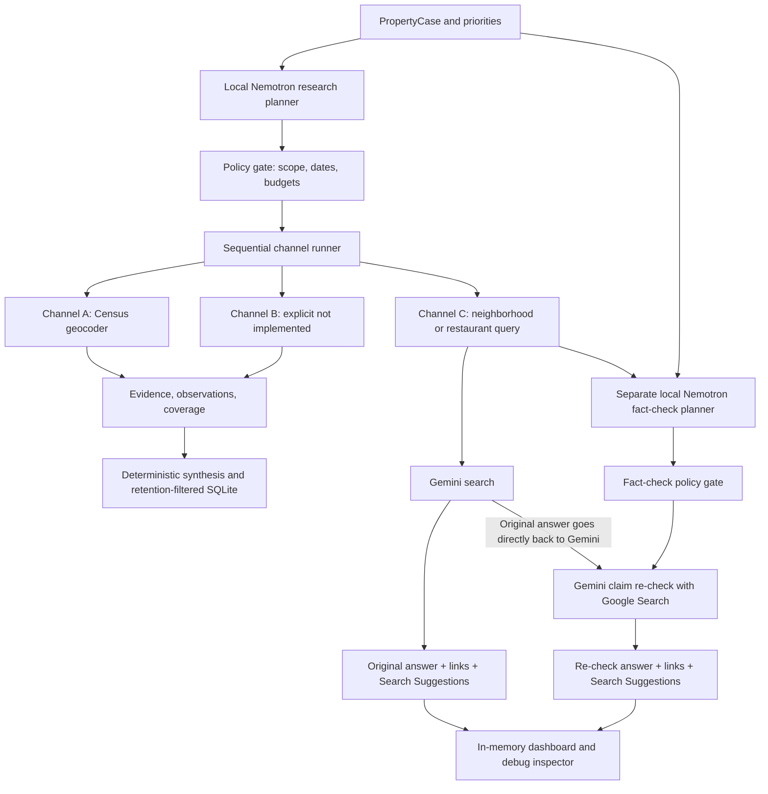

# Architecture and decisions

## Downstream handoff

CLI development runs now save `DevelopmentSnapshot` JSON under
`exports/<run-id>.json` before opening the viewer, including original/re-check
web responses, source metadata and supports. This is a local display-debugging
copy, explicitly labeled `development_debug` / `development_file`, separate from
durable evidence exports and SQLite. Files persist until manually deleted;
`exports/` is Git-ignored and `--no-save-json` disables saving.
An explicit `--export PATH` saves the same full snapshot at that path, replacing
its previous contents. `--durable-export PATH` selects the filtered contract.
The viewer includes an escaped, indented full JSON section and pretty-prints its
JSON endpoint and Nemotron's JSON responses. Debug request and
response payloads are excluded. Viewer model text is rendered with markdown-it-py,
with raw HTML disabled, unsafe URL schemes rejected and remote images suppressed;
the provider text stored in the JSON is unchanged.

For same-application user viewing, `synthesis/frontend.py` builds a separate
`FrontendResponse`: the main report plus original/re-check web responses, all
source chunks, support mappings and Search Suggestions. The token-protected
viewer exposes it at `/<token>/result.json` with no-store headers. A frontend can
acknowledge completion with `POST /<token>/release`; this clears the display
buffers and ends the viewer, which also expires after 15 minutes. The frontend
contract is documented in [frontend-response.md](frontend-response.md).

The optional durable step is `--durable-export PATH`: a versioned `ResearchExport` JSON
bundle, written before the dashboard starts. `store/export.py` and SQLite share
`durable_report()` as their retention boundary. The export carries the property
case, plan, durable observations and evidence, rebuilt claims, coverage, and demo
marker. Consumers resolve claim IDs to observation/evidence IDs and retain source
qualifiers and flags. `omissions` explicitly identifies excluded web topics and
evidence/observation counts. The Pydantic model exposes a JSON Schema.

Live Google-grounded content and debug payloads never enter the durable handoff. Thus
the current web channel cannot supply downstream tour-script inputs; it remains
a separate transient display. Filling that gap requires a source/permission
model allowing downstream processing, not a change to serialization alone.

## Current scope

One Python package, asyncio, Pydantic contracts, httpx clients and SQLAlchemy/SQLite.
Pittsburgh, Pennsylvania is the first geography. Local Ollama runs
`nemotron-3-nano:4b`; Gemini `gemini-3.8-flash` provides Google Search grounding.
The CLI and temporary loopback dashboard are the entry points. There is no agent
framework, crawler, public deployment or separate agent service. Audience is still
pending; use remains local research.

## Data flow

Nemotron has two separate stateless roles, system prompts and structured outputs:

- **Research planner:** selects channels and emits bounded `ResearchQuerySpec` objects.
- **Fact-check planner:** emits a `FactCheckPlan` for each displayed live search result.
  It receives only the property case and approved query, never the grounded answer.
  Python validates the plan and calls its Gemini re-check tool once.

The checker plans location, date, independent-source, contradiction and opinion/fact
checks. Restaurant research also checks restaurant identity, general vicinity and review
freshness. It does not require proving the radius or precise dates to retain useful themes. Gemini receives its earlier answer directly and is instructed to
assess each material claim as corroborated, contradicted, unresolved or opinion,
with explanations, citations, dates and useful follow-up questions.

Opinions are first-class findings: retain them with attribution and an explicit opinion
label, without demanding objective truth or independent agreement. Mixed statements
are split into factual components to check and subjective components to preserve.
Lack of a precise review date is a limitation, not a reason to discard an opinion.

These verdicts are Gemini model assessments. They are not independently verified
facts, a calibrated confidence score or an automated guarantee of source independence.
The result remains a readable attributed answer, not parsed verification JSON or a
new dossier claim. Repeated search results do not establish independent evidence.
A re-check failure leaves the original search display available.

## Live grounding policy

The [Gemini grounding terms](https://ai.google.dev/gemini-api/terms) restrict downstream
analysis and permit specified resubmission of a grounded answer to Google to refine
it. On 2026-10-03 the user selected **Nemotron-planned Gemini re-checks** rather than
sending grounded text to Nemotron. This is the conservative integration boundary;
it does not constitute legal clearance for production.

Both displayed answers retain their own source links and Search Suggestions and
remain transient in the live viewer, with the explicitly enabled local development
snapshot exception described above. The source policy continues to set `extract: false`
for `gemini_search`. Neither original nor re-checked content is sent to Nemotron,
merged into official observations or persisted to SQLite; development snapshots
save their full display payloads for local debugging.
Debug response payloads remain transient and are not an export endpoint. Review
terms, attribution and display behavior before production launch.

Synthetic fixtures retain the original extraction/verifier pipeline for tests. Its
same-segment text/date/geography checks validate textual support, not factual truth.
There is no live extracted-evidence provider yet.

## Channel C specialists

`neighborhood_discussion` uses discussion sources, exact case geography and a bounded
date window. `restaurant_reviews` uses review sources with an exact property-address
anchor and a default 1,000-meter approximate radius (schema bounds: 100–5,000 meters).
The research planner is prompted for one query per selected supported topic.

Restaurant prompts use broad semantic Google Search across general reviews, local
food publications and Google Reviews for up to three restaurants in the immediate
vicinity of the address. `address_anchor` and `radius_meters` remain in the JSON for
downstream use; the model is not required to verify an exact radius or numeric
proximity. The date bounds are recency context, not strict publication-date filters.
Prefer recent review themes. If snippets lack specific themes, provide an attributed
general reputation summary based on available search results, labeled as opinion.

There is no `site:yelp.com` operator, Yelp-specific failure clause or Google Places
API integration. Source links and grounded metadata remain necessary for display;
no evidence is invented to fill genuine source gaps. Direct page fetching, reviewer
identification and full review reproduction remain outside this pipeline.

Live CLI defaults to both supported topics. Repeat `--topic` to select a subset.
The offline demo still uses its fixed synthetic neighborhood fixture.

## Contracts and persistence

The top-of-viewer source inventory derives API providers from returned evidence
and coverage provider IDs, user-document entries from supplied evidence, and web
links from actual display grounding chunks. Web links are deduplicated across
search and re-check while retaining topic/stage labels and cited/uncited status.
Unknown redirect destinations are not inferred. Proposed sources are documented
separately in [proposed-sources.md](proposed-sources.md).

Every channel returns `ChannelResult(observations, evidence, coverage)`; evidence
references must resolve. Census also exposes `fetch(case, ctx)`. Successful live web
coverage says `complete` with **Search completed · displayed separately**. That status
means successful retrieval/display, not factual verification. The checker contributes
its own `fact_checker` coverage row. Empty, blocked, truncated and error outcomes
remain distinct.

`LiveDisplay` includes topic and stage so original and re-check panels can be followed.
These displays and `RunOutcome.debug_events` are outside the persisted `RunReport`.
The SQLite store filters provider retention, rebuilds claims from durable evidence,
and removes web/fact-check coverage details and trace text. It uses a small JSON
run envelope; normalized tables and migrations can follow multi-user requirements.

## Budgets, orchestration and failures

Defaults per run: two initial grounded requests, two separately budgeted fact-check
requests, four local LLM calls, two official API calls, 2,048 generated tokens per local call and 4,096 per Gemini call, 60 seconds per request and a shared 180-second deadline. The checker usually
adds one local Nemotron call and one Gemini call per displayed research result.
There are no automatic retries or model fallbacks. Calls reserve their budget before
dispatch; the checker checks its search budget before spending another local call.
Oversized plans and mismatched geography/address fail closed. Before validating a
fact-check plan, the runner adds policy-required checks omitted by the model and
deduplicates its checklist. This changes neither scope nor factual assessments;
the model proposal, added checks and effective plan are all visible in debug output.

`max_queries` defaults to 3 (allowed values 1–3) and is guidance for Gemini's internal
searches in both research and re-check requests. Each specification still dispatches
one API request; the plan gate checks `len(plan.queries)` against the application-call
budget. The prompt has no one-search restriction. Gemini controls its actual search
count, so this field is not an enforced provider-side cap. Output caps are not total billing
caps. Provider quotas and usage reporting govern deployment costs. Query caching,
provider-specific rate limits and durable cost accounting are not implemented.

## Debug view

The dashboard presents a completed-run snapshot with numbered request/response steps:
research Nemotron → research policy → Gemini search → fact-check Nemotron → fact-check
policy → Gemini re-check. Exact submitted JSON, readable prompts, full responses,
parsed handoffs, duration and HTTP status are inspectable. Only the two implemented
model roles and policy stages are captured as detailed events; channel traces also
show Census/listing execution. This is actual payload inspection, not inferred reasoning.

Authentication headers are never captured and known key values are redacted. All
JSON/HTML content is escaped; Search Suggestions are rendered in a sandboxed iframe.
Loopback-only binding, random URL token and no-store headers remain in place. SSH
port forwarding exposes this temporary viewer to the operator's browser. There is no
live progress stream, public dashboard or static grounded-content export.

## Next integrations

Allegheny County assessor and Pittsburgh permits are the next official local data
sources after access/policy review. ACS/FEMA/OSM, PDF page evidence, photo questions,
assessor discrepancies, structured conflict analysis and labeled-property evaluation
remain unimplemented. The current Census adapter verifies an address-range match,
not parcel identity or structural condition.

References: [Ollama chat](https://docs.ollama.com/api/chat),
[Gemini GenerateContent grounding](https://ai.google.dev/gemini-api/docs/generate-content/google-search),
[Census geocoder](https://geocoding.geo.census.gov/geocoder/Geocoding_Services_API.html).

## Small-model scope reliability

Live testing exposed Nemotron copying future dates and abbreviated geography into
query specs. The planner now builds a per-case constrained JSON schema: geography,
address anchor and the default past-year date bounds are constants. The fact-check
schema likewise fixes its topic/geography to the approved query. The model still
selects channels, topics and checks; it cannot rewrite those scope identifiers.
The deterministic policy gate remains in place after schema validation.

Gemini 3.8 Flash uses LOW thinking with a 4,096-token generation cap. Live testing
showed a re-check exhausting the earlier 2,048-token cap before returning citation
support; truncated responses now remain explicitly truncated rather than empty.
